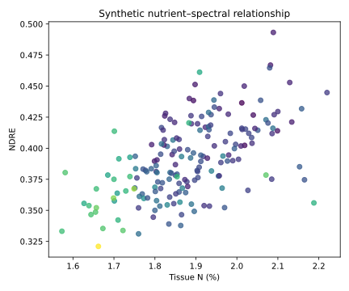
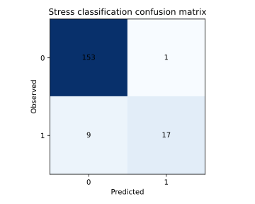

# GeoAI Multi-Sensor Crop Stress Monitoring

Integrate satellite-style indices, canopy features, hyperspectral summaries, soil and weather variables in a reproducible crop-stress workflow. Python demos support evaluation and scouting outputs; Earth Engine scripts provide a separate public Sentinel-2 processing pathway.

## Workflows

| Pathway | Data and validation | Outputs |
|---|---|---|
| [Multi-sensor extension](multisensor/) | Fictional spatial grid; five-fold validation by disjoint spatial block | Held-out probabilities, feature importance, uncertainty proxy and synthetic scouting GeoJSON |
| Nutrient/stress demo | Generated independent sample rows; stratified classification CV and random regression CV | Stress/nutrient predictions, anomaly scores, plots and metrics |
| [Sentinel-2 Earth Engine](gee/south_florida_real_case.js) | Public imagery; requires an authorized Earth Engine run | Vegetation indices and satellite processing outputs |

## Quick start

```bash
python -m pip install -r requirements.txt
python scripts/run_demo.py
python multisensor/run_demo.py
python -m pytest -q
python -m streamlit run dashboard/app.py
```

## Computed nutrient-demo outputs




[Model metrics](results/model_metrics.csv) · [Stress predictions](results/stress_predictions.csv) · [Nutrient predictions](results/nutrient_predictions.csv)

The first demo's stress target is derived from generated nutrient conditions. Nutrient predictors are available to the model, so the score checks the implementation and does not establish early diagnosis from satellite data alone. Tissue-nitrogen regression uses spectral, soil and weather predictors rather than its target as an input.

## Multi-sensor spatial evaluation

The extension models generated Sentinel-2-style NDVI/NDRE/EVI/NDWI, UAV height/texture, hyperspectral features, soil moisture and weather. Spatial fold membership is saved with the results. Its tree-to-tree prediction spread is an uncertainty proxy, not a calibrated interval. Scouting thresholds are illustrative.

Real data need aligned timestamps, field IDs, CRS, spatial footprints, consistent units and independently observed target labels. Merge by vetted sampling units, then select holdouts that represent the sites and seasons where predictions will be used.

## Data availability

Public demo inputs and outputs are synthetic. Real UAV, spectral, soil and weather observations have not been jointly calibrated in this demo. Earth Engine imagery processing is separate from the local tests. See [data notes](data/README.md), [satellite guide](docs/real_sentinel2_case_study.md) and [verification notes](docs/verification.md).
